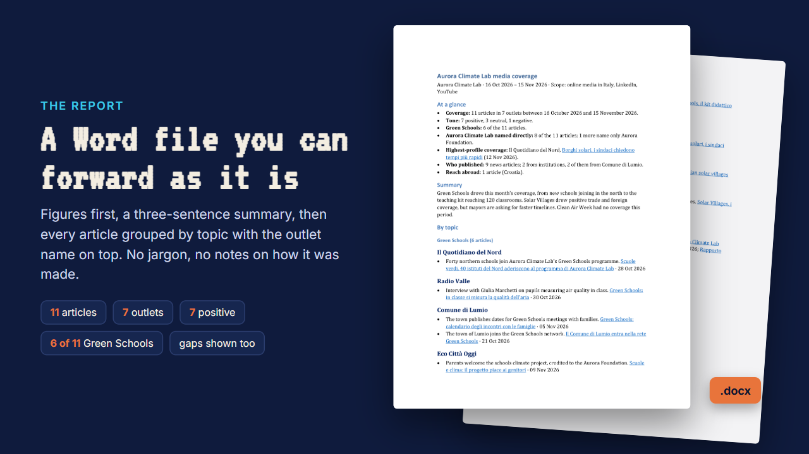
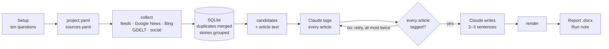
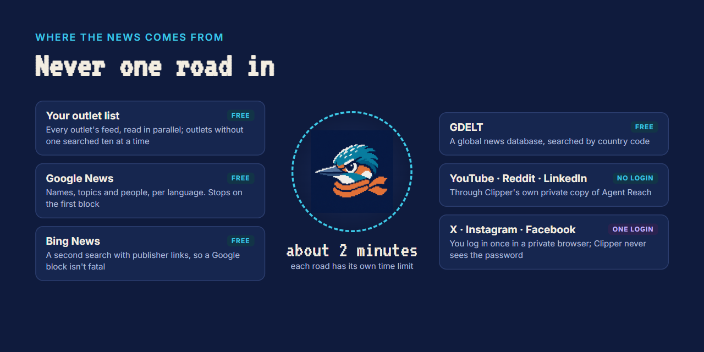

<p align="center">
  
</p>

<h3 align="center">Media monitoring for small teams, run by Claude.</h3>

<p align="center">
  Every week, Clipper finds what the news and social media said about you, in any country.<br>
  Claude reads it all and writes a short Word report you can send straight on.<br>
  Setup takes ten clicks.
</p>

<p align="center">
  
  
  
  
  
  
</p>

<p align="center">
  <a href="#install"></a>
  &nbsp;
  <a href="#the-report"></a>
  &nbsp;
  <a href="#frequently-asked-questions"></a>
</p>

<p align="center">
  <b>Free and open source (MIT).</b> No Clipper account, no subscription, no Clipper server in the middle.<br>
  Everything runs on your computer, inside your own Claude.
</p>

---

## Contents

- [Why Clipper](#why-clipper)
- [How it compares](#how-it-compares)
- [Install](#install)
- [Your first report in fifteen minutes](#your-first-report-in-fifteen-minutes)
- [The setup: click through, don't chat](#the-setup-click-through-dont-chat)
- [The report](#the-report)
- [How it works](#how-it-works)
- [Where the news comes from](#where-the-news-comes-from)
- [Social media, step by step](#social-media-step-by-step)
- [What Clipper refuses to do](#what-clipper-refuses-to-do)
- [What it costs](#what-it-costs)
- [Everyday use](#everyday-use)
- [Your project files and settings](#your-project-files-and-settings)
- [Frequently asked questions](#frequently-asked-questions)
- [Command line](#command-line)
- [For developers](#for-developers)
- [Status and known issues](#status-and-known-issues)
- [Roadmap](#roadmap)
- [Credits and licence](#credits-and-licence)

---

## Why Clipper

It's Monday morning and your manager wants to know how last week's launch landed in the press. You open Google News, type the organisation's name, then its Italian name, then the acronym, then the product name. You paste fifteen links into a document. Half of them are the same press release reprinted by six sites. Two are job adverts. One is about a different organisation with a similar name. You write three lines on top, and by the time it's sent it's Tuesday.

The tools that do this properly, the media monitoring suites big organisations use, cost thousands a year on an annual contract. Google Alerts is free, but it sends you a list of links, misses most local outlets and can't tell you whether an article is positive, which topic it's about, or whether it even names you.

**Clipper sits in between.** It does what a junior press officer does every week, the same way every time:

- **It knows where to look.** In setup, Clipper builds a source list for your country (national papers, regional papers, agencies, TV and radio, think tanks, ministries), checks that every site answers and finds its news feed. Then it searches Google News, Bing News and GDELT on top, and social media if you want it.
- **It reads everything.** Claude reads each article and decides whether it's really about you or just a passing mention. It notes the tone with a one-line reason, which topic it's about, whether you're named directly or only your parent body, and what kind of piece it is.
- **It writes a report people actually read.** Figures first, a three-sentence summary, then every article grouped by topic, with the outlet name on top. Topics with no coverage stay in the report, because the gaps matter too.
- **It tells you what it missed.** A private run note lists the outlets that didn't answer and the searches that failed. The report itself never mentions any of this, so you can forward it untouched.

Clipper was built for small communications teams: start-ups, small companies, agencies, non-profits, research groups. That means anyone with a press presence and no monitoring budget. It's not tied to one country: you give it a country and the languages its press writes in, and it starts from there.

---

## How it compares

|  | **Clipper** | Commercial monitoring suites | Google Alerts | Doing it by hand |
|---|---|---|---|---|
| **Price** | Free; uses your Claude plan | Annual contract, typically thousands a year | Free | Free, costs hours |
| **Setup** | Ten clickable questions | Onboarding with a sales team | Type a keyword | None |
| **Local outlets** | A checked source list for your country, built in setup | Large paid databases | What Google happens to index | What you remember to check |
| **Reads the articles** | Yes: relevance, tone, topic, how you're named | Usually, with automated sentiment | No | Yes, slowly |
| **Duplicates and reprints** | Merged, and the same story is grouped across outlets | Usually | No | By hand |
| **Ready-to-send report** | A Word file, ready to forward | Dashboards and exports | An email of links | You write it |
| **Social media** | YouTube, Reddit, LinkedIn; X, Instagram, Facebook after one login | Broad, paid | No | By hand |
| **Your data** | Stays on your computer | On the vendor's servers | Google account | Your files |

If you need print monitoring, broadcast transcripts, a database of journalists or hundreds of keywords across dozens of markets, a commercial suite is the right tool. If you need a weekly, trustworthy answer to "what did the press say about us?", Clipper is built for that.

---

## Install

Clipper is a plugin for **Claude Code**, which runs in the terminal or in the Code tab of the Claude desktop app. Pick the path that matches how comfortable you are.

| You need | Why |
|---|---|
| Claude Code (terminal or desktop app) | Clipper runs inside it, with your own Claude account |
| Python 3.12 or later | The collecting and report-building part is Python |
| [uv](https://docs.astral.sh/uv/) | Installs Clipper's Python packages on first run. On Windows without uv on the PATH, Clipper calls it as `python -m uv`. |

<details>
<summary><b>Level 1: from GitHub, in Claude Code (recommended)</b></summary>

1. Get the code. With the GitHub CLI: `gh repo clone meavuk/clipper`. Or with git:

   ```bash
   git clone https://github.com/meavuk/clipper.git
   ```

2. In Claude Code, add the folder as a plugin marketplace, then install the plugin. Type each line on its own:

   ```
   /plugin marketplace add "C:\path\to\clipper"
   /plugin install clipper@clipper-local
   ```

3. Start a **new** Claude Code session, so the plugin's skills load.
4. Say **set up Clipper**. The first command installs Clipper's Python packages, which takes about a minute, and then the setup screens appear.

</details>

<details>
<summary><b>Level 2: the Claude desktop app, from a zip</b></summary>

1. Make a plugin zip from the code: `git archive --format=zip -o clipper.zip HEAD` (or ask whoever gave you Clipper for `clipper-demo-v1.2.zip`).
2. In the Claude desktop app, upload the zip as a plugin.
3. Start a new session and say **set up Clipper**.

</details>

<details>
<summary><b>Updating to a new version</b></summary>

Pull the latest code (`git pull`), then in Claude Code run:

```
/plugin marketplace update clipper-local
/plugin install clipper@clipper-local
```

Start a new session. Your projects, reports and history are kept: they live in your own folder, not in the plugin.

</details>

<details>
<summary><b>If the first run says a file is in use (Windows)</b></summary>

On a first install, antivirus software sometimes scans the new Python environment while uv is still writing it, and the install stops with "os error 32". Say "try again". The second attempt works.

</details>

---

## Your first report in fifteen minutes

1. **Say "set up Clipper".** A welcome screen lists what Clipper can watch. Click **Start setup**.
2. **Answer the questions** by clicking: organisation, country, languages, names to search, topics and people, what to leave out, kinds of sources, social media, how often, who reads it. That takes about five minutes.
3. **Approve your source list.** Clipper shows something like "110 sources for Italy: 26 national, 23 regional, 11 agencies…" with a few well-known names. Add or remove sources, or click **Looks good**.
4. **Look at the test.** Clipper runs every search on last week's news and shows how many articles each one found. A search that finds nothing, or finds far too much, gets a plain-words warning and a fix.
5. **Approve the cost.** For example: "Each weekly report uses about 40,000 tokens." Nothing runs until you click **Approve**.
6. **Choose a schedule, or skip it.**
7. **Say "run my media report".** About two minutes of collecting, a minute or two of reading, and Claude tells you where the Word file is.

---

## The setup: click through, don't chat

<p align="center"></p>

Each screen asks one question, offers clickable answers and says in one line what happens next. There's no chatter between screens and no technical words. If you ask something mid-setup, Claude answers in a sentence or two and shows the same screen again.

| # | Screen | What happens with your answer |
|---|---|---|
| 0 | **Welcome** | What Clipper can watch, and how long setup takes |
| 1 | **Organisation** | Its name, translations and acronym become searches |
| 1b | **Existing project** | Only if you already have one: **update it** (every answer pre-filled, history kept) or **start fresh** (old files moved to a backup folder) |
| 2 | **Country** | Clipper will build that country's source list at the end |
| 3 | **Languages** | Searches run in every language you tick |
| 4 | **Names to search** | Only the names the press really uses. Parent bodies (the foundation behind a lab, say) are noted for sorting, not searched on their own. |
| 5 | **Topics and people** (products, campaigns, events, programmes) | Often find more coverage than the organisation's name. Everyday words and short acronyms only count next to your name. |
| 6 | **Leave out** | Your own websites and social accounts, job adverts, other meanings of your name |
| 7 | **Types of sources** | National, regional, agencies, TV and radio, trade and specialist press, think tanks, government and institutions |
| 8 | **Social media** | LinkedIn, YouTube, Reddit, X, Instagram, Facebook |
| 9 | **How often** | Weekly (Monday morning), daily or monthly; each report covers everything since the last one |
| 10 | **Who reads it** | Just you, your team, management, clients or partners |
| 10b | **Social login** | Only for X, Instagram or Facebook: one login in a private browser |
| 11 | **Your source list** | Researched, checked and shown for approval |
| 12 | **Test on last week** | Every search tried on the last seven days, with warnings and fixes |
| 13 | **Cost** | Tokens per report and per month; you approve, or ask for a cheaper plan |
| 14 | **Schedule** | Optional automatic runs on this computer |
| 15 | **Done** | The date of your first report |

The full design, with every screen's exact wording, is in [`docs/setup-wizard.md`](docs/setup-wizard.md).

---

## The report

<p align="center"></p>

This is a real Clipper report, rendered by Clipper's own code, for **Aurora Climate Lab**: a made-up organisation with made-up outlets and articles, so no real data appears here. Reports for real organisations look exactly like this.

<details>
<summary><b>See the first page full size</b></summary>
<p align="center"></p>
</details>

### How it's laid out

| Part | What's in it | Who writes it |
|---|---|---|
| **Header** | Organisation · period · scope ("online media in Italy, LinkedIn, YouTube") | Clipper |
| **At a glance** | Articles and outlets · tone (positive, neutral, negative) · the main topic's share · how often you're named directly, and how often only your parent body · the highest-profile outlet · news versus institutional sources · reach abroad · change since the last report | Clipper, counted from the tags. Claude never types a number. |
| **Summary** | Two or three sentences: what drove coverage, and anything your readers should know | Claude |
| **By topic** | One heading per topic with its article count. Under it, the **outlet name in bold**, then one line per article: a one-sentence English description, the original headline as a link, and the date. | Clipper lays it out; Claude writes the descriptions. |

A few details that matter to readers:

- **Gaps stay visible.** A topic with no articles keeps its heading and says "No coverage this period."
- **Reprints are grouped.** When the same story runs in several outlets, they share one heading ("Notizie Verdi and Radio Valle"). Several articles from one outlet sit under a single outlet name.
- **Links go to the publisher**, not to an aggregator's redirect page.
- **Topics can share a heading.** For example, "Solar Villages and Clean Air Week", set with `report_groups`. You can also rename the heading for coverage outside your topics, for example "Other coverage of Aurora Climate Lab".
- **Long months stay short.** Past 40 articles (you can change this), each topic lists the most important articles and adds a line like "Plus 12 more articles".

The Markdown copy of that report is in [`examples/sample-report.md`](examples/sample-report.md).

### The run note: for you only

Next to every report, Clipper writes a **run note** that you keep and don't forward:

- which outlets were reached and which didn't answer, and why;
- how each search route did, and which ones only covered part of the period;
- how many articles were collected, picked, tagged and reported;
- anything removed from Claude's draft (an invented link, or a sentence about how articles were found);
- the tokens this run used, next to the estimate you approved.

---

## How it works

<p align="center"></p>

Clipper splits the work in two:

- **Python does everything that must be exact:** searching, reading feeds, removing duplicates, grouping stories, counting, linking and building the Word file.
- **Claude does what needs judgement:** asking the setup questions, reading each article, tagging it, and writing the short summary.

Every Clipper command prints exactly **one JSON object**. The skills (Claude's instructions, in `skills/`) read it and decide what to tell you, so Claude never has to guess from a log what happened.



### One run, step by step

1. **Collect.** Every route runs at once, each with its own time limit, so collecting takes about one to two minutes. Clipper drops articles outside the period, articles from your own sites and job boards, and words that only count next to your name when they appear alone. Duplicates are merged. The same story in different outlets is grouped.
2. **Pick.** The most promising articles are kept (up to 180 by default). For up to 30 of them, Clipper fetches the article text. When a link is a Google News redirect, it first finds the publisher's own page.
3. **Tag.** A fast Claude model (Haiku) reads every candidate and returns, for each one:
   - whether it is relevant
   - its type (news, interview, opinion, press release reprint, event listing, institutional)
   - its tone, with a reason
   - how the organisation is named
   - the topic
   - a one-sentence description
   - the outlet's country
4. **Check.** Clipper accepts the tags only when **every** article has exactly one valid tag. Missing ones go back to the tagger, at most twice. If it's still incomplete, there's no report: Clipper would rather say "I couldn't finish" than send a false "no coverage".
5. **Summarise.** Claude writes two or three sentences from the tagged data alone.
6. **Render.** Clipper builds the Word file, a Markdown copy and the run note.

---

## Where the news comes from

<p align="center"></p>

Clipper never depends on one route. If one fails, the others carry on, and the run note says what happened.

| Route | What it does | Cost |
|---|---|---|
| **Your outlet list** | Reads the news feed of every outlet on your checked list, in parallel. Outlets without a feed are searched ten at a time with one site-restricted search. | Free |
| **Google News** | Searches your names, topics and people for the period, in each language. At the first sign that Google wants it to slow down, it stops for the rest of the run, so a block costs seconds, not half an hour. | Free |
| **Bing News** | A second, independent search that links to the publisher's own page. A result must really name one of your search terms. When Google blocks, Bing and the feeds still bring the news in. | Free |
| **GDELT** | A global news database, searched with your country's code (249 countries mapped). | Free |
| **Brave News** | An independent index, used only if you save your own key in `~/.clipper/brave-key.txt`. Never needed. | Paid, optional |

**Source lists.** Each project gets its own `sources.yaml`. In setup, Claude researches the country's outlets by type and Clipper checks each one: does the site answer, and where is its feed? You see the result before you approve it. A ready-made, checked list ships for Italy. Every other country gets its list built in setup.

**Searches.** Clipper builds them from four kinds of terms in your plan:

- **Subject:** the names that count as a mention.
- **Contexts:** words that only count next to a subject name. For example, an acronym that is also an everyday word.
- **Topics** and **people:** searched on their own.

Each search engine gets the searches in its own syntax.

---

## Social media, step by step

Social search runs through a **private, pinned copy of [Agent Reach](https://github.com/Panniantong/Agent-Reach) 1.6.1** that is installed with Clipper. It runs from its own folder (`~/.clipper/reach`) and its own browser port, so **your own Agent Reach, browser and accounts are never touched.**

| Platform | How Clipper finds posts | Login |
|---|---|---|
| **YouTube** | Searched directly; each video's date is read so it lands in the right period | None |
| **Reddit** | Searched directly | None |
| **LinkedIn** | Public posts, found through web search | None |
| **X, Instagram, Facebook** | Through a private browser that belongs to Clipper | Once, by you |
| **TikTok** | Not supported yet | |

<details>
<summary><b>Setting up X, Instagram or Facebook</b></summary>

1. On setup screen 8, tick the platforms you want.
2. Screen 10b explains that Clipper will install its own private browser. It's a download of a few hundred MB, and your own browser isn't changed. Click **Set it up now**.
3. For each platform a login window opens. Log in yourself, then close the window. Clipper never sees or asks for your password.
4. Clipper checks each platform. Any that still need a login are named in one line, and setup carries on without them.

To skip this, click **Skip these platforms**: the rest of Clipper works without them.

</details>

Posts without a date are left out, because they can't be placed in a period. So are posts from your own accounts, which you list on screen 6.

---

## What Clipper refuses to do

Clipper is built so a report can't quietly be wrong, and so it never does anything you didn't ask for.

- **It never invents a link.** Claude's draft can't contain links at all. Every headline link comes from stored data, and any link typed into the draft is removed and noted in the run note.
- **It never sends a false "no coverage".** If tagging isn't complete, there is no report.
- **It never puts a number in Claude's hands.** Every figure in "At a glance" is counted by Clipper from the tags.
- **It never explains its methods to your readers.** Sentences about Google, GDELT, feeds, search engines, scraping, AI or tokens are removed from the report and listed in your run note.
- **It never works around a paywall.** Subscriber-only pages are marked "subscribers only". Their headline counts, and their text is not taken.
- **It never follows instructions found in an article.** Article text is data. The tagger and the summary writer are told to ignore anything in it that reads like an instruction.
- **It never posts, likes, comments or messages.** Social access is read-only.
- **It never asks for your passwords,** and it never creates accounts for you.
- **It never touches your own tools.** Your own Agent Reach install and your own browser stay as they are.
- **It never sends your data anywhere new.** There is no Clipper server. Articles are read by Claude in your own Claude account, and everything else stays in your project folder.

---

## What it costs

Clipper is free, and every built-in news route is free. The only cost is **Claude usage**: mostly the tagger reading articles, plus a little for the summary.

- **Before anything runs,** setup screen 13 shows the tokens per report and per month, and waits for your approval.
- **Real numbers:** in the first field test, a monthly report with about 20 candidate articles used about **40,000 tokens**.
- **Every run note** shows what that run actually used.
- **To make it cheaper,** ask on screen 13, or later say "make my media report cheaper". Fewer sources, stricter searches and a lower article cap all reduce the cost.

---

## Everyday use

Just talk to Claude.

| Say | What happens |
|---|---|
| **run my media report** | Collect, read, write and save the Word file. If the last collection never became a report, Clipper finishes that one first. |
| **run my media report for 1 to 31 October** | Same, for a period you choose |
| **media monitoring status** | When the last report ran, what it found, which sources failed |
| **add a topic to monitor** | Adds it, tests it on last week, shows the new cost |
| **exclude this website from my media report** | Drops it from every future report |
| **add an outlet** or **remove an outlet** | Changes your source list; new sites are checked first |
| **group Solar Villages and Clean Air Week under one heading** | Sets `report_groups` |
| **set up Clipper** (again) | Update the existing project, or start fresh |

Reports and run notes are saved in `Documents\Clipper\<project name>\`.

---

## Your project files and settings

Each project lives in its own folder:

```
Documents/Clipper/Aurora Climate Lab/
├── project.yaml     the plan: names, topics, country, languages, how often
├── sources.yaml     your checked source list
├── data.sqlite      every article, tag and run
├── reports/         the Word reports, plus a Markdown copy
├── run-notes/       what was checked and missed, for you only
└── work/<run>/      working files for each run (candidates, tags, summary draft)
```

Setup writes `project.yaml` for you; you never have to open it.

<details>
<summary><b>Every field in project.yaml</b></summary>

```yaml
name: Aurora Climate Lab             # the project's short name
organisation: Aurora Climate Lab     # shown in the report
subject:                             # names that count as a mention; each one is searched
  - Aurora Climate Lab
  - Laboratorio Clima Aurora
parent_names:                        # the parent body: used for sorting, never searched alone
  - Aurora Foundation
contexts:                            # words that only count next to a subject name
  initiatives: [ACL]
programmes: [Green Schools, Solar Villages, Clean Air Week]   # your topics: products, campaigns, events
spokespeople: [Giulia Marchetti]
exclude_domains: [auroraclimatelab.example]   # your own websites
exclude_terms: [internship, tirocinio, job vacancy]
own_accounts: []                     # your own social handles, as they appear in the web address
social: [linkedin, youtube]          # x, linkedin, instagram, facebook, youtube, reddit
report_groups:                       # optional: topics that share one report heading
  Solar Villages and Clean Air Week: [Solar Villages, Clean Air Week]
  other: Other coverage of Aurora Climate Lab   # heading for coverage outside your topics
competitors: {}
country: IT                          # two-letter ISO code
languages: [it, en]
frequency: weekly                    # daily | weekly | monthly
readers: Management
report_language: en                  # English only for now
caps:                                # optional limits
  max_candidates: 180                # articles sent to the tagger
  max_fulltext: 30                   # articles whose full text is fetched
  max_report_items: 40               # articles listed in the report
```

</details>

<details>
<summary><b>A tip on parent bodies</b></summary>

If your parent body's name (for example "Aurora Foundation") is also in `subject`, every article that names only the parent counts as naming you directly. Leave the parent only in `parent_names` if you want the report to tell the two apart: "8 of the 11 articles name you; 1 more names only Aurora Foundation".

</details>

---

## Frequently asked questions

**Is Clipper free?**
Yes. It's open source under the MIT licence, with no paid tier and no Clipper account. Its only cost is the Claude usage it adds to your own plan, which setup estimates for you before anything runs.

**Do I need an API key?**
No. Clipper runs inside Claude Code with your own Claude account. The only optional key is Brave News, which nobody needs.

**Which countries does it work for?**
Any country. You give a country and the languages its press writes in. Italy has a ready-made, checked outlet list. For every other country, setup researches and checks the list for you.

**Which languages can the report be in?**
English, for now. Searches run in every language you tick, and the report describes each article in English while keeping the original headline.

**How far back can it look?**
Each report covers the period since the last one. You can also ask for a specific period, for example "run my media report for September". Many outlet feeds only reach back a few days, though, so a long look-back relies more on the search routes. See [known issues](#status-and-known-issues).

**Does it read paywalled articles?**
No. Subscriber-only pages are marked "subscribers only" in the report. They're still counted, from their headline and summary, but Clipper never works around a paywall.

**Will Claude make up articles, links or numbers?**
No. Claude can only refer to articles Clipper collected. Every link comes from stored data, and every number in "At a glance" is counted by Clipper, not written by Claude. The run note lists anything removed from Claude's draft.

**What if tagging fails halfway?**
Clipper retries the missing articles at most twice. If it still can't finish, it tells you so and writes no report, rather than a misleading one.

**Can I monitor more than one organisation?**
Yes. Each organisation is its own project with its own folder, source list and history. Say which one when you ask for a report.

**Can I change the report layout?**
You can group topics under shared headings, rename the "other coverage" heading, and change how many articles are listed. The section order is fixed, because it follows what readers asked for in the field test.

**Why a Word file and not a PDF or a web page?**
That's what readers asked for in the field test. A Word file can be forwarded, attached, edited and printed, and it keeps working links. A Markdown copy is saved next to it for your records.

**Does it email the report?**
Not yet. The Word file is saved in your project folder. Email delivery is on the roadmap.

**Does it post anything on social media?**
Never. Social access is read-only.

**Do you see my social media passwords?**
No. For X, Instagram and Facebook, you log in yourself in a private browser window that belongs to Clipper. Clipper never sees or stores your password.

**I already use Agent Reach. Will Clipper change it?**
No. Clipper uses its own private copy, in its own folder, on its own browser port. Your install is never touched.

**What happens when Google blocks me?**
Heavy use can make Google ask a connection to slow down for a few hours. Clipper notices the first refusal and stops asking Google for the rest of the run. Bing News and your outlet feeds carry on. Coverage is thinner during a block, and the run note says so.

**Can it run on a schedule?**
Setup can schedule runs on your computer. The computer has to be on at that time, and a missed run is covered by the next one.

**Where is my data stored?**
In your project folder on your computer: the plan, the source list, a SQLite database of articles and tags, the reports and the run notes. Nothing goes to a Clipper server, because there isn't one.

**Does it work on Mac and Linux?**
The code is plain Python and should run anywhere Claude Code and Python do.

**I set up a project once. Can I change my answers?**
Yes. Say "set up Clipper" again and choose **Update it**: every screen is pre-filled with your current answers, and your history is kept. Or ask for a single change, like "add a topic to monitor".

---

## Command line

The skills run these for you, so you never have to type them. They're listed for developers and for checking things by hand. Run them as `uv run clipper <command> …`, or from anywhere as `python -m uv run --directory "<plugin folder>" clipper …`. Every command prints one JSON object, and errors look like `{"ok": false, "error": "…"}`.

<details>
<summary><b>All commands</b></summary>

| Command | What it does |
|---|---|
| `init --name --country --languages [--folder] [--replace]` | Create a project. `--replace` starts fresh and moves the old plan, source list and history into a backup folder; reports stay. |
| `projects` | List projects and their folders |
| `sources --project [--add FILE] [--remove DOMAINS] [--tiers TIERS]` | Show, build or change the source list; checks sites and finds feeds |
| `test-queries --project [--days N]` | Run the plan on recent news, flag weak searches and save a cost estimate |
| `collect --project [--since ISO --until ISO] [--skip ROUTES]` | Collect coverage (default: since the last report) |
| `candidates --project --run ID --out FILE` | Export the articles to tag, with full text where available |
| `apply-tags --project --run ID --tags FILE` | Validate a tagging batch. It's accepted only when complete; otherwise it lists `missing_ids`. |
| `draft-input --project --run ID --out FILE` | Export the tagged data the summary is written from |
| `render --project --run ID --draft FILE` | Build the report (.docx and .md) |
| `status --project` | The last run, what it found, and failed sources |
| `social-setup` · `social-check` · `social-login --platform` | Install and check the private social browser |
| `compare` · `compare-score` | Compare search routes on the same period (a developer tool) |

</details>

---

## For developers

<details>
<summary><b>Run the tests and try it locally</b></summary>

```bash
uv sync
uv run pytest                                    # about 280 tests; no network, no real keys
uv run clipper --help
```

Run Clipper with a throwaway home folder, so your real settings stay untouched:

```bash
HOME=/tmp/clipper-home uv run clipper collect --project <your project name>
```

</details>

<details>
<summary><b>Code map</b></summary>

```
clipper/
├── .claude-plugin/        plugin and marketplace manifests
├── skills/
│   ├── setup/             the setup screens (SKILL.md) and scheduling instructions
│   ├── run/               one report, end to end, including the tagging retry rules
│   ├── status/            the last run at a glance
│   └── edit/              change the plan
├── src/clipper/
│   ├── cli.py             every command; one JSON object out
│   ├── collectors/        outlet_feeds · google_news · bing_news · gdelt · brave · social
│   ├── queries.py         searches from the plan, in each engine's syntax
│   ├── pipeline.py        collect → filter → de-duplicate → store; candidate export
│   ├── dedupe.py          URL normalisation and story grouping
│   ├── fulltext.py        article text (trafilatura) and subscriber-only detection
│   ├── gnews_links.py     Google News redirect → publisher link
│   ├── tags.py            tag validation and the complete-batch rule
│   ├── layout.py          the report: figures, topic groups, Word output
│   ├── render.py          summary clean-up, report files, run note
│   ├── estimate.py        last-week test and cost estimate
│   ├── sources.py         per-project source lists and site checks
│   ├── countries.py       country names and GDELT codes
│   ├── store.py           SQLite store
│   └── data/              countries.yaml and bundled outlet lists
├── tests/                 about 280 tests
├── examples/              an example project and a sample report
├── assets/                banner, logo and README images
└── docs/                  design, setup screens and test plans
```

</details>

<details>
<summary><b>Design rules</b></summary>

- **Python owns anything exact:** counts, links, dates and files. Claude owns judgement and prose.
- **One JSON object per command.** Never a traceback.
- **Every network route has a time limit** and stops at its first "slow down". One failing source never stops a run.
- **Article text is never an instruction.**
- **Tests never call the network** and never use a real key.
- **Say what's built.** A feature isn't listed as working until it has worked.

</details>

<details>
<summary><b>Docs</b></summary>

- [`docs/2026-11-14-media-monitor-design.md`](docs/2026-11-14-media-monitor-design.md): the original design (under the working name "media-monitor")
- [`docs/setup-wizard.md`](docs/setup-wizard.md): every setup screen
- [`docs/brave-test-plan.md`](docs/brave-test-plan.md): how a second search route is compared with Google
- [`docs/spikes/scheduled-run.md`](docs/spikes/scheduled-run.md): notes on scheduled runs

</details>

---

## Status and known issues

Clipper is a **demo (v1.2)**. It has had one full field test, with a real organisation in Italian media over one month: 20 relevant articles in 15 outlets, all tagged on the first try. Here is what works and what doesn't.

**Works**

- Any country, set by country code and languages.
- Collection in about one to two minutes, with free fallbacks when Google blocks.
- The setup screens, including updating an existing project.
- The report as a Word file, with every figure counted by Clipper.
- The complete-tagging rule, the link guard and the method-word guard.
- Social search for YouTube, Reddit and public LinkedIn posts.

**Weak, or not yet checked**

- **Shallow feeds.** Many outlet feeds only reach back a few days, so a first run or a 30-day look-back misses older articles from those sites. Regular weekly or monthly runs avoid this.
- **GDELT** usually runs out of its time limit and adds little.
- **Google** can block a connection for hours after heavy use. Clipper fails fast and falls back to Bing and the feeds, but coverage is thinner.
- **Publisher-link tracing for Google News** is tested with recorded responses, not yet against live Google.

---

## Roadmap

- [ ] Calibrate the cost estimate from real runs
- [ ] A daily feed check, so shallow feeds never leave gaps
- [ ] A longer time limit for GDELT, or run it on its own
- [ ] Group the same story across languages
- [ ] Email delivery of the Word report
- [ ] Reports in other languages
- [ ] Coverage trends across reports
- [ ] Ready-made outlet lists for more countries

---

## Credits and licence

- Social search through **[Agent Reach](https://github.com/Panniantong/Agent-Reach)** by Panniantong, used as a pinned private copy.
- Article text by **[trafilatura](https://github.com/adbar/trafilatura)**.
- Word files by **[python-docx](https://github.com/python-openxml/python-docx)**.
- News data from **[GDELT](https://www.gdeltproject.org/)** and the public Google News and Bing News feeds.

Clipper is released under the **MIT licence**; see [LICENSE](LICENSE).

<p align="center">
  <br>
  <sub>Clipper reads the news so you don't have to.</sub>
</p>
