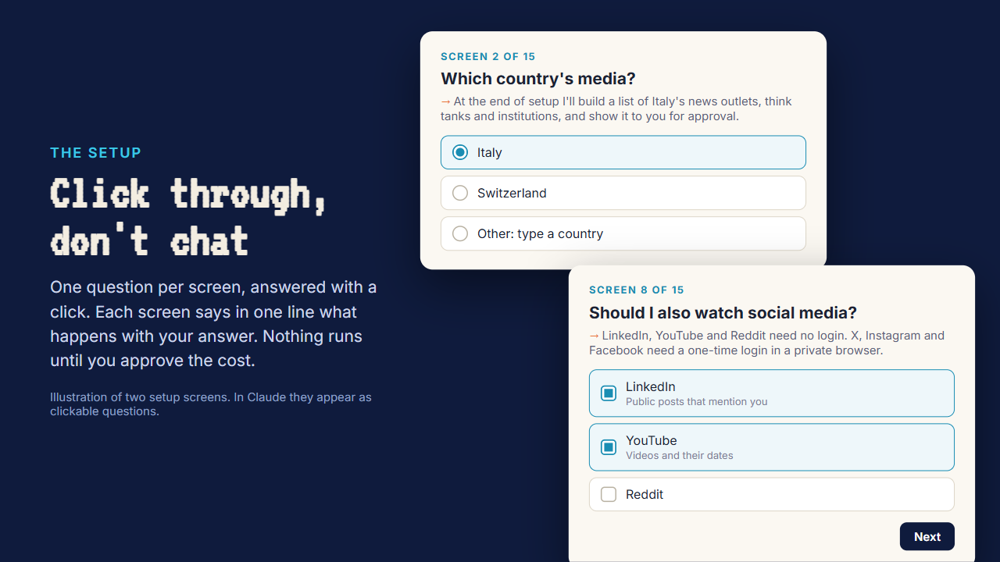
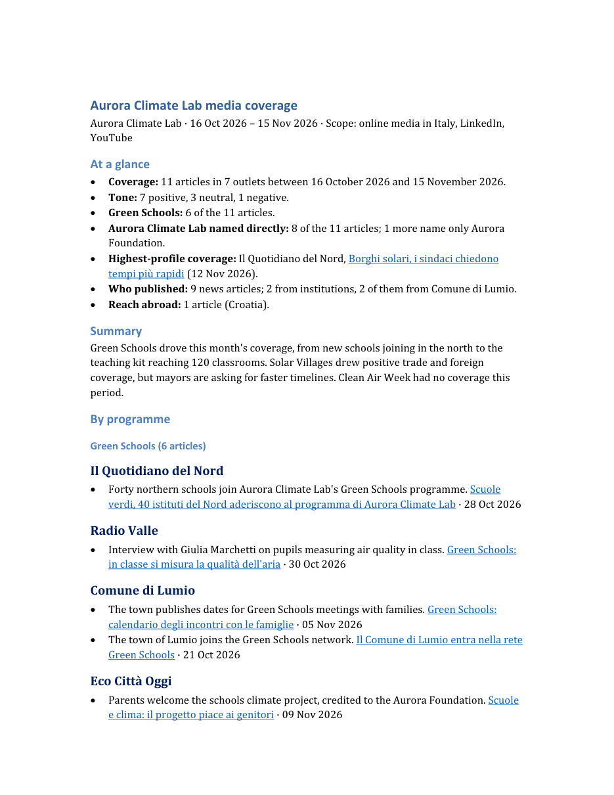
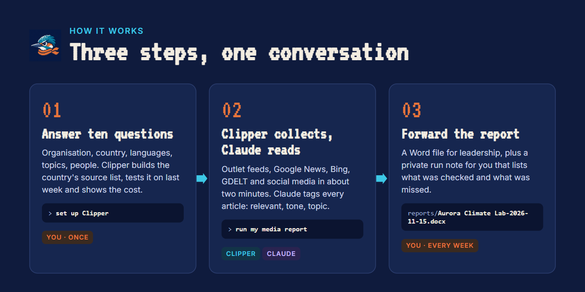
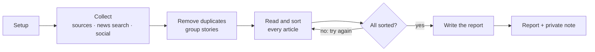

<p align="center">
  
</p>

<h3 align="center">Media monitoring for small teams.</h3>

<p align="center">
  Clipper finds what the news and social media are saying about your organisation, in any country,<br>
  and turns it into a short report you can share.
</p>

<p align="center">
  
  
  
  
  
</p>

<p align="center">
  <a href="#install"></a>
  &nbsp;
  <a href="#the-report"></a>
  &nbsp;
  <a href="#frequently-asked-questions"></a>
</p>

<p align="center">
  <b>Free and open source.</b> No account, no subscription, no server in the middle.<br>
  Everything runs on your computer.
</p>

---

## Contents

- [What Clipper does](#what-clipper-does)
- [How it compares](#how-it-compares)
- [Install](#install)
- [Getting started](#getting-started)
- [Setup](#setup)
- [The report](#the-report)
- [How it works](#how-it-works)
- [Where the news comes from](#where-the-news-comes-from)
- [Social media](#social-media)
- [What Clipper won't do](#what-clipper-wont-do)
- [What it costs](#what-it-costs)
- [Everyday use](#everyday-use)
- [Frequently asked questions](#frequently-asked-questions)
- [For developers](#for-developers)
- [Known limits](#known-limits)
- [Roadmap](#roadmap)
- [Credits and licence](#credits-and-licence)

---

## What Clipper does

Keeping track of your press coverage is slow work. You search for your name, then its translation, then the acronym, then each product or campaign. You sort out the reprints, the job adverts and the namesakes, then write it all up for someone else to read. Monitoring tools do this for you, but they're priced for large companies.

Clipper does the same job for small teams, the same careful way every time.

- **It knows where to look.** During setup it builds a source list for your country: national and regional news, agencies, TV and radio, trade press, think tanks and public institutions. Every site is checked before it goes on the list. News searches and social media come on top.
- **It reads what it finds.** For each article, Clipper decides whether it's really about you or only a passing mention. It also records the tone, the topic it covers, and whether you're named directly.
- **It writes a report people actually read.** The figures come first, then a short summary, then every article grouped by topic with the outlet's name on top. Topics with no coverage stay in, because gaps matter too.
- **It tells you what it missed.** A private note lists the sources that didn't answer. The report itself never mentions any of that, so you can share it untouched.

It works for any organisation with a press presence: a start-up, a small company, an agency, a non-profit, a research group. And it works for any country, in the languages its press writes in.

---

## How it compares

|  | **Clipper** | Monitoring suites | News alerts | By hand |
|---|---|---|---|---|
| **Price** | Free | Annual contracts | Free | Your time |
| **Setup** | A few clickable questions | A sales process | One keyword | None |
| **Local outlets** | A checked list for your country | Large paid databases | Whatever the search engine finds | Whatever you remember |
| **Reads the articles** | Relevance, tone, topic, how you're named | Usually | No | Yes, slowly |
| **Reprints** | Merged and grouped by story | Usually | No | By hand |
| **Ready to share** | Yes | Dashboards and exports | A list of links | You write it |
| **Social media** | Yes | Yes, paid | No | By hand |
| **Your data** | Stays on your computer | On the vendor's servers | In your account | In your files |

If you need print and broadcast monitoring, journalist databases or hundreds of keywords across many markets, a full suite is the right tool. If you need a dependable answer to "what's being said about us?", Clipper is built for exactly that.

---

## Install

Clipper is a plugin for [Claude Code](https://claude.com/claude-code), in the terminal or the desktop app.

| You need | Why |
|---|---|
| Claude Code | Clipper runs inside it |
| Python 3.12 or later | For the collecting and report building |
| [uv](https://docs.astral.sh/uv/) | Installs Clipper's packages on first run. On Windows, Clipper also works with `python -m uv`. |

<details open>
<summary><b>From GitHub</b></summary>

1. Get the code:

   ```bash
   git clone https://github.com/omerkavuk/clipper.git
   ```

2. In Claude Code, add the folder and install the plugin. Type each line on its own:

   ```
   /plugin marketplace add "<path to the clipper folder>"
   /plugin install clipper@clipper-local
   ```

3. Start a new session and say **set up Clipper**.

</details>

<details>
<summary><b>From a zip, in the desktop app</b></summary>

1. Make a zip of the code: `git archive --format=zip -o clipper.zip HEAD`.
2. In the desktop app, upload the zip as a plugin.
3. Start a new session and say **set up Clipper**.

</details>

<details>
<summary><b>Updating</b></summary>

Run `git pull`, then:

```
/plugin marketplace update clipper-local
/plugin install clipper@clipper-local
```

Your projects and reports aren't touched. They live in your own folder, not in the plugin.

</details>

---

## Getting started

1. Say **set up Clipper** and answer the questions by clicking.
2. Look over the source list Clipper builds for your country. Add or remove sources, or accept it.
3. Check the test: every search runs on last week's news, so you can see what each one finds before anything is saved.
4. Approve the cost estimate. Nothing runs until you do.
5. Say **run my media report** whenever you want one, or let Clipper run on a schedule.

---

## Setup

<p align="center"></p>

Setup asks one question per screen. You answer with a click, and each screen says in one line what will happen with your answer.

| Question | What it decides |
|---|---|
| **Organisation** | The name to watch, with its translations and acronym |
| **Country and languages** | Which press to read, and in which languages to search |
| **Names** | The names that count as a mention. A parent organisation can be noted too: it helps sort articles but isn't searched on its own. |
| **Topics and people** | Products, campaigns, events and spokespeople. These often find more coverage than the organisation's name. Words that are too common only count next to your name. |
| **Leave out** | Your own websites and accounts, job adverts, and other things that share your name |
| **Kinds of sources** | National, regional, agencies, broadcasters, trade press, think tanks, institutions |
| **Social media** | Which platforms to watch |
| **How often** | Daily, weekly or monthly, or only when you ask |
| **Who reads it** | You, your team, management, or clients and partners |

Then Clipper builds and checks your source list, tests the searches, shows the cost, and offers to set a schedule. If you already have a project, setup asks whether to update it (your answers are filled in for you) or to start fresh.

---

## The report

<p align="center"></p>

The example shows a made-up organisation, Aurora Climate Lab, with made-up outlets and articles.

<details>
<summary><b>See the first page full size</b></summary>
<p align="center"></p>
</details>

| Part | What's in it |
|---|---|
| **At a glance** | The figures: articles and outlets, tone, the leading topic, how often you're named directly, the most prominent outlet, news versus institutional sources, coverage abroad, and the change since the last report |
| **Summary** | Two or three sentences on what drove coverage |
| **By topic** | One heading per topic, with its article count. Under each heading come the outlet names, each followed by its articles: a one-line description, the original headline as a link, and the date. |

A few details:

- **Gaps stay visible.** A topic with no coverage keeps its heading.
- **Reprints are grouped.** One story in several outlets appears once, with all the outlets named.
- **Links go to the publisher's own page.**
- **Topics can share a heading,** and you can rename the heading for everything else.
- **Busy periods stay short.** Past a limit you set, each topic shows the most important articles and a count of the rest.

### The private note

Next to each report, Clipper keeps a note for you alone: which sources were reached and which weren't, what each search route found, and what the run cost. The report never mentions any of this.

---

## How it works

<p align="center"></p>



1. **Collect.** The sources are searched one after another, each with its own time limit, so a run takes minutes. Anything outside the period, from your own sites or from job boards is dropped.
2. **Clean up.** Duplicates are merged, and one story across several outlets is grouped together.
3. **Read and sort.** Each article is checked for relevance and tagged with its tone, topic, type, and how you're named. Where possible, the full text is read from the publisher's page.
4. **Check.** The report is only written once every article has been sorted. If something can't be finished, Clipper says so instead of reporting "no coverage".
5. **Write.** The figures are counted, never estimated. The summary is short. Links come straight from the sources.

---

## Where the news comes from

<p align="center"></p>

Clipper never depends on a single route. If one fails, the others carry on.

| Route | What it does | Cost |
|---|---|---|
| **Your source list** | Reads every outlet on your checked list. Outlets without a news feed are searched directly. | Free |
| **Google News** | Searches your names, topics and people in every language you chose | Free |
| **Bing News** | A second, independent search, so one blocked route never means an empty report | Free |
| **GDELT** | A global news database, searched by country | Free |
| **Brave News** | An extra independent index, used only if you add your own key | Optional, paid |

Your source list is built for your country during setup. You can add or remove outlets at any time.

---

## Social media

| Platform | Login needed |
|---|---|
| YouTube | No |
| Reddit | No |
| LinkedIn (public posts) | No |
| X, Facebook | Once, by you, in a private browser window |
| Instagram (posts from accounts you choose to watch) | Once, by you, in a private browser window |

Social search runs through a private copy of [Agent Reach](https://github.com/Panniantong/Agent-Reach), kept apart from anything else on your computer. Clipper never sees your passwords, and it only reads: it never posts, likes or comments. Your own accounts are left out of the results.

---

## What Clipper won't do

- **Invent a link.** Every link in the report comes from a source that was actually found.
- **Guess a number.** Every figure is counted.
- **Report "no coverage" by mistake.** If sorting isn't finished, there's no report.
- **Talk about its methods to your readers.** Sentences about searches, feeds or tools are kept out of the report.
- **Get around a paywall.** Subscriber-only articles are marked as such.
- **Follow instructions hidden in an article.** Article text is treated as content, never as commands.
- **Post anything, or ask for your passwords.**
- **Send your data anywhere new.** There's no Clipper server.

---

## What it costs

Clipper is free, and so are all its built-in news routes. The only cost is the usage it adds to your Claude plan. Setup shows an estimate per report and per month before anything runs, and each private note shows an estimate for that run, worked out from its article counts. To bring the cost down, use fewer sources, stricter searches or a lower article limit. You can ask for any of these at any time.

---

## Everyday use

| Say | What happens |
|---|---|
| **run my media report** | Collects, reads and writes the report |
| **run my media report for March** | The same, for a period you choose |
| **media monitoring status** | When the last report ran and what it found |
| **add a topic to monitor** | Adds it and tests it |
| **exclude this website** | Keeps it out of future reports |
| **add an outlet** / **remove an outlet** | Changes your source list |
| **put these two topics under one heading** | Groups them in the report |
| **set up Clipper** | Update your project, or start a new one |

<details>
<summary><b>Where your files live</b></summary>

Each project has its own folder, by default `Documents/Clipper/<project name>/`:

```
├── project.yaml     your answers: names, topics, country, languages
├── sources.yaml     your checked source list
├── data.sqlite      everything collected and sorted
├── reports/         your reports
└── run-notes/       your private notes
```

</details>

<details>
<summary><b>Every setting in project.yaml</b></summary>

Setup writes this file for you. This is the example project:

```yaml
name: Aurora Climate Lab
organisation: Aurora Climate Lab
subject:                     # names that count as a mention
  - Aurora Climate Lab
  - Laboratorio Clima Aurora
parent_names: [Aurora Foundation]   # used for sorting, not searched on its own
contexts:                    # words that only count next to a name
  initiatives: [ACL]
programmes: [Green Schools, Solar Villages, Clean Air Week]   # your topics
spokespeople: [Giulia Marchetti]
exclude_domains: [auroraclimatelab.example]   # your own websites
exclude_terms: [internship, job vacancy]
own_accounts: []             # your own social accounts
social: [linkedin, youtube]
report_groups:               # optional: topics that share a heading
  Solar Villages and Clean Air Week: [Solar Villages, Clean Air Week]
  other: Other coverage of Aurora Climate Lab
country: IT                  # two-letter country code
languages: [it, en]
frequency: weekly            # daily | weekly | monthly
readers: Management
report_language: en
caps:                        # optional limits
  max_candidates: 180
  max_fulltext: 30
  max_report_items: 40
```

</details>

---

## Frequently asked questions

**Is it free?**
Yes, under the MIT licence. The only cost is your own Claude usage, and setup estimates it before anything runs.

**Do I need an API key?**
No.

**Which countries does it work for?**
Any country. You choose the country and the languages its press writes in, and setup builds the source list.

**What language is the report in?**
English for now. Searches run in every language you choose, and the original headlines are kept.

**What period does a report cover?**
Everything since the last report, or any period you ask for.

**Does it read paywalled articles?**
No. They're counted and marked "subscribers only".

**Can it make up articles, links or numbers?**
No. Every article and link comes from a real source, and every figure is counted.

**Can I watch more than one organisation?**
Yes. Each one gets its own project, source list and reports.

**Can I change the report?**
You can group topics, rename headings and set how many articles are listed.

**Does it post on social media, or need my passwords?**
No and no. It only reads, and you log in yourself where a login is needed.

**I already use Agent Reach. Will Clipper change it?**
No. Clipper keeps its own separate copy.

**What if a news search is blocked?**
The other routes carry on, and the private note says what happened.

**Can it run on a schedule?**
Yes, on your computer. If the computer was off, the next run covers the missed period.

**Where is my data stored?**
In your project folder, on your computer.

**Can I change my answers later?**
Yes. Say "set up Clipper" and choose to update, or ask for a single change.

---

## For developers

<details>
<summary><b>Run the tests</b></summary>

```bash
uv sync
uv run pytest        # no network, no real keys
uv run clipper --help
```

</details>

<details>
<summary><b>Command line</b></summary>

The plugin runs these for you. Every command prints one JSON object.

| Command | What it does |
|---|---|
| `init --name --country --languages [--folder] [--replace]` | Create a project; `--replace` starts fresh and keeps a backup |
| `projects` | List projects |
| `sources --project [--add FILE] [--remove DOMAINS] [--tiers TIERS]` | Show or change the source list |
| `test-queries --project [--days N]` | Test the searches and estimate the cost |
| `collect --project [--since --until] [--skip ROUTES]` | Collect coverage |
| `candidates --project --run ID --out FILE` | Export articles to sort |
| `apply-tags --project --run ID --tags FILE` | Accept a sorting batch, only when it's complete |
| `draft-input --project --run ID --out FILE` | Export the sorted data for the summary |
| `render --project --run ID --draft FILE` | Build the report and the private note |
| `status --project` | The last run at a glance |
| `social-setup` · `social-check` · `social-login --platform` | Set up social access |

</details>

<details>
<summary><b>Code map</b></summary>

```
├── .claude-plugin/       plugin manifests
├── skills/               setup · run · status · edit
├── src/clipper/
│   ├── cli.py            commands
│   ├── collectors/       source list · Google News · Bing News · GDELT · Brave · social
│   ├── queries.py        searches built from your answers
│   ├── pipeline.py       collect, filter, de-duplicate, store
│   ├── dedupe.py         duplicates and story grouping
│   ├── fulltext.py       article text and paywall detection
│   ├── gnews_links.py    publisher links behind Google News links
│   ├── tags.py           checks that every article is sorted
│   ├── layout.py         the report layout
│   ├── render.py         report files and private note
│   ├── estimate.py       search test and cost estimate
│   ├── sources.py        source lists and site checks
│   └── store.py          storage
├── tests/
├── examples/             the Aurora Climate Lab example
└── docs/                 design notes
```

</details>

<details>
<summary><b>Design rules</b></summary>

- Code handles anything exact: counts, links, dates and files.
- Every command prints one JSON object, never a traceback.
- Every network route has a time limit, and one failing source never stops a run.
- Article text is never treated as an instruction.
- Tests never touch the network.

</details>

---

## Known limits

- Many news feeds only go back a few days, so the first report or a long look-back can miss older articles. Regular reports avoid this.
- GDELT is slow and often adds little.
- A news search can be blocked for a while after heavy use. Clipper switches to its other routes, but coverage is thinner until the block lifts.

---

## Roadmap

- [ ] Email delivery
- [ ] Reports in other languages
- [ ] Coverage trends across reports
- [ ] Grouping the same story across languages
- [ ] Ready-made source lists for more countries

---

## Credits and licence

- Social search through [Agent Reach](https://github.com/Panniantong/Agent-Reach) by Panniantong
- Article text by [trafilatura](https://github.com/adbar/trafilatura)
- Documents by [python-docx](https://github.com/python-openxml/python-docx)
- News data from [GDELT](https://www.gdeltproject.org/), Google News and Bing News

MIT licence; see [LICENSE](LICENSE).

<p align="center">
  <br>
  <sub>Clipper reads the news so you don't have to.</sub>
</p>
